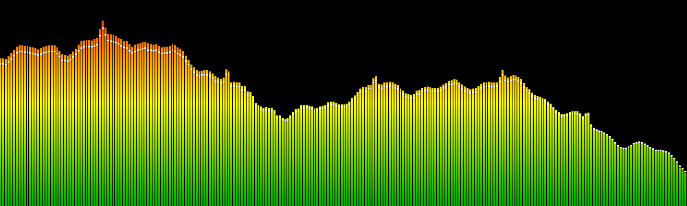
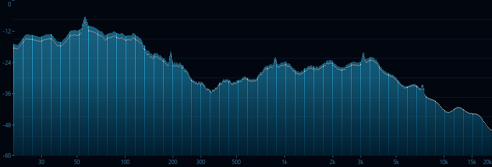
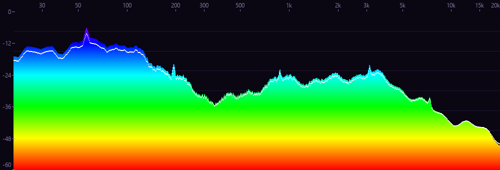
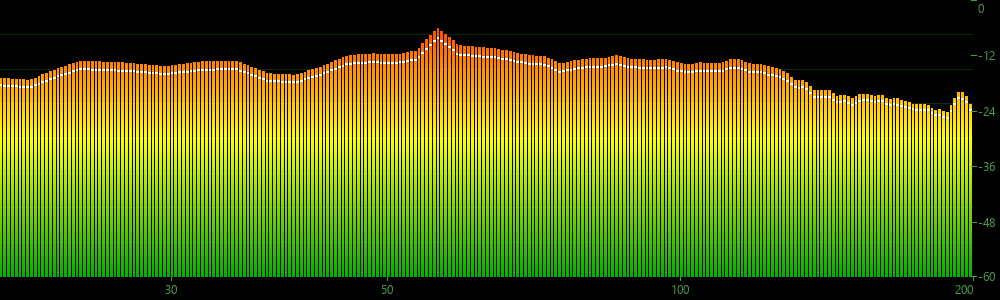
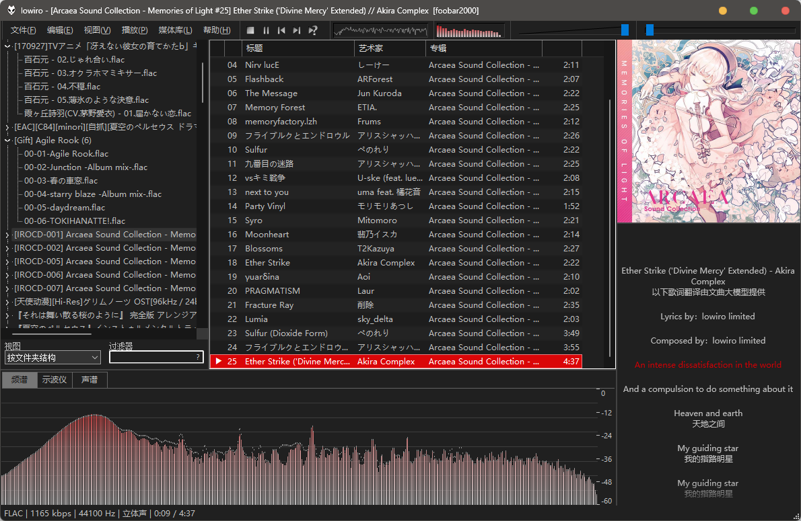

# 本项目使用Deepseek实现

# 频谱可视化 · foo_spectrum

foobar2000 的频谱面板。最多 1024 段，渐变、颜色、刻度位置都能自己配，帧率上限 240。
500 Hz 以下单独走一路 16384 点长窗 FFT，低频不会糊成一片。

另带一个 **Spek 风格的频谱图**：整首曲子画成时间×频率热力图，并给出估计的截止频率。

    

## 安装

参数设置（`Ctrl+P`）→ 组件 → 安装… → 选中 `.fb2k-component` → 应用 → 按提示重启。

不能双击安装：foobar2000 不注册 `.fb2k-component` 关联。升级直接覆盖，不用先卸载。

## 使用

`视图 → 可视化 → 频谱可视化`，双击全屏。常驻成面板：布局编辑模式下右键面板 →
`替换 UI 元素…` → 选「频谱可视化」。

面板右键四项：`设置面板…`、`颜色设置…`、`频谱图（判断是否无损）…`、`高级设置…`。

## 频谱图

`视图 → 可视化 → 频谱图（判断是否无损）…`，或频谱面板右键同一项。点 `分析当前曲目`
或 `打开文件…`。

有损编码会把高频一刀切掉，切在哪由码率决定：

| 截止位置 | 通常对应 |
| --- | --- |
| 接近采样率上限（44.1 kHz 时约 22 kHz） | 带宽完整，无损或 320 kbps 级别 |
| 约 20 kHz | 常见于 320 kbps |
| 约 18–19 kHz | 常见于 192–256 kbps |
| 约 16 kHz | 常见于 128 kbps |

**只是提示，不是证据**：母带本身可能就限带，320 kbps 也能顶到 20 kHz 以上。要确定得看形状 ——
有损在截止处是一条水平切边，而不是自然滚降。

窗口选项（会记住）：

- **频率轴**：线性 / 对数
- **调色板**：经典（黑→蓝→青→绿→黄→红）/ 热力图（黑→紫→品红→红→橙→黄→白，即 Spek 那套）/ 灰度 / 青蓝
- **上限**：频率轴顶端。`自动` = 采样率的一半，画面铺满；也可往里裁以放大某一段。
  列表只列出该文件实际能裁的值 —— 超过奈奎斯特的地方没有数据。
- **范围**：动态范围 70–160 dB，默认 120（Spek 同色标）
- **导出 PNG…**：3000×1024

## 设置

| 设置 | 默认 | 设置 | 默认 |
| --- | --- | --- | --- |
| 波段数量 | 256（64–1024） | 刷新率 | 60 FPS |
| FFT 点数 | 自动 | 上升 / 下落时间 | 0 / 90 ms |
| 频率范围 | 20–20000 Hz | 峰值下落 | 60 %/s |
| 显示样式 | 柱状 + 峰值保持 | 增益 | 100 % |
| 渐变 | 三色，垂直 | 频谱倾斜 | 0 dB/oct |
| 低频增强 | 开 | 网格 / 频率刻度 / 电平刻度 | 关 |

**频谱倾斜**：以 1 kHz 为轴心、每倍频程 ±12 dB。音乐每倍频程天然衰减约 6 dB，填正值把高频
抬起来曲线就平了。它不是「增益」—— 增益是全频段统一乘，改不了斜率。

**频率上下限**是把选中区间放大铺满面板，不是留空。

## 配色与外观预设

面板右键 → `颜色设置…`。内置 7 组配色：经典绿 / 深海蓝 / 落日火焰 / 彩虹 / 霓虹紫 / 琥珀示波器 / 黑白。

自定义预设存**整套外观**（最多 32 个）。老版本存的预设仍可用。

## 配置文件

设置面板底部可导出 / 导入 `.ini`。没写到的项保持当前值，越界值自动收敛。
